# Board

Written by `python -m contextbench board`. Do not edit it by hand: run records in `results/public/` make it. README.md says how the numbers are made.

- Exact: the share of gold turns whose full text is in the context, mean over the questions. Words: the share of the gold answer's words in the context.
- Cost: per request of the replay, in ace_bench's token units (0.1 per cached token, 1.25 per other token), and in dollars of input at the dated price card (cached tokens at the cache-read price, the others at the 5-minute cache-write price).
- Charts: under the tables of each source, made from the same records by `python -m contextbench plot`.
- Over budget: the harness does not cut a request. It counts the requests over the budget and the tokens over it. Newest dropped: requests that did not end with the newest message.

## codex-sessions, budget 32768 tokens

Chats: 403. Requests per engine: 6488. Source SHA-256: 62c628656764…. Price card: 2026-10-07.

| # | Engine | Version | Tokens/request | Cost units/request | $/request Sonnet 5.5 | $/request Haiku 5.5 | Cache reuse | Max request | Requests over | Tokens over | Newest dropped | Select ms p50 |
|---|---|---|---|---|---|---|---|---|---|---|---|---|
| - | breadcrumbs-ace | 0.4.1 (5be1e74) | 18214 | 3790.9 | 0.005932 | 0.000379 | 0.906 | 79584 | 763 | 10709362 | 0 | 0.17 |
| - | drop | 1 | 12274 | 2794.6 | 0.004498 | 0.000279 | 0.889 | 32729 | 0 | 0 | 0 | 0.03 |
| - | langchain-trim | 1.8.0 | 10145 | 2435.3 | 0.003980 | 0.000244 | 0.878 | 32759 | 0 | 0 | 1352 | 0.05 |
| - | llamaindex-buffer | 0.14.25 | 10231 | 2542.5 | 0.004194 | 0.000254 | 0.871 | 32729 | 0 | 0 | 0 | 0.08 |
| - | window | 1 | 16884 | 8582.6 | 0.016076 | 0.000858 | 0.645 | 32768 | 0 | 0 | 0 | 0.04 |

This source has no questions. It measures exposure and cost, not accuracy or behavior: the board names no engine ahead.

Runner: breadcrumbs-agency (maintainer), macOS arm64, Python 3.14.7.

### Charts of codex-sessions

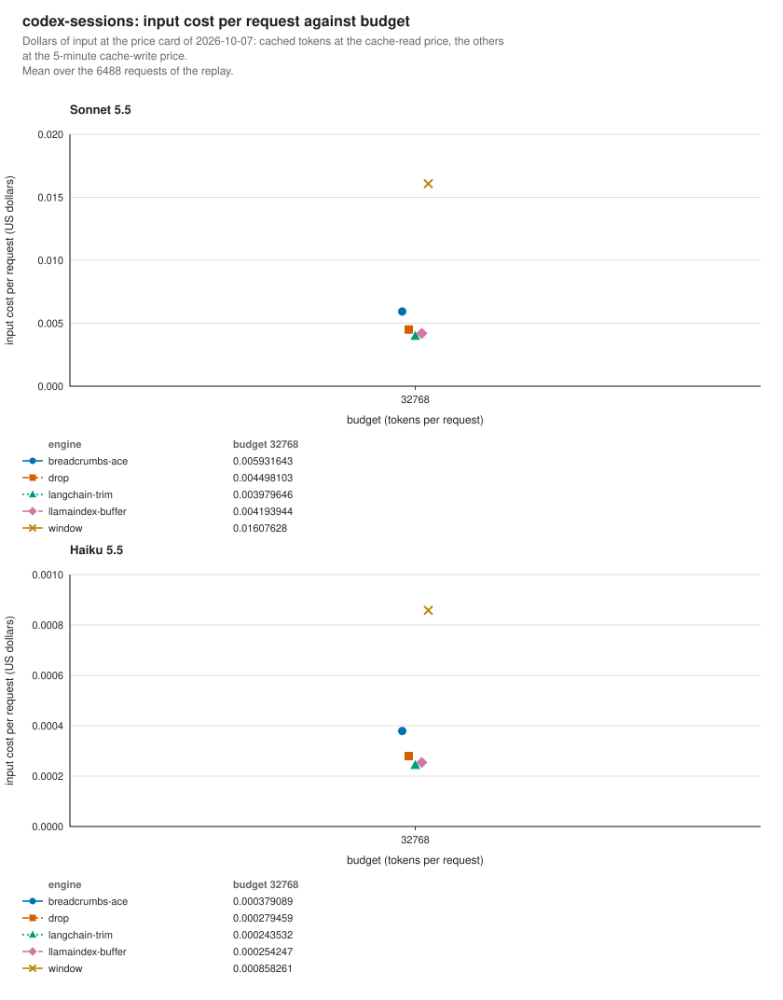

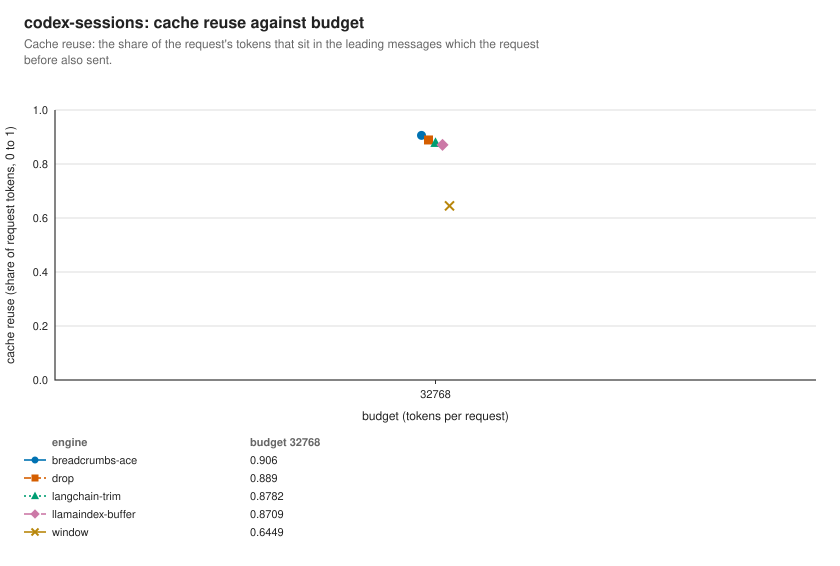

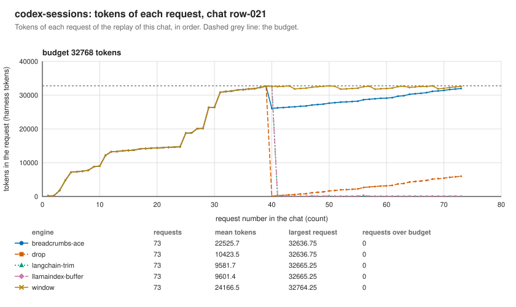

## locomo, budget 4096 tokens

Chats: 10. Questions: 1981. Requests per engine: 2938. Source SHA-256: 79fa87e90f04…. Question set: 14dd0b5a6b2e…. Price card: 2026-10-07.

| # | Engine | Version | Exact | Words | Context tokens | Tokens/request | Cost units/request | $/request Sonnet 5.5 | $/request Haiku 5.5 | Cache reuse | Max request | Requests over | Tokens over | Newest dropped | Select ms p50 |
|---|---|---|---|---|---|---|---|---|---|---|---|---|---|---|---|
| ceiling | full | 1 | 1.000 | 0.902 | 24497 | 12319 | 1325.7 | 0.001428 | 0.000133 | 0.993 | 28749 |  |  | 0 | 0.01 |
| 1 | window | 1 | 0.174 | 0.457 | 4075 | 3703 | 4018.6 | 0.007984 | 0.000402 | 0.143 | 4096 | 0 | 0 | 0 | 0.09 |
| 2 | langchain-trim | 1.8.0 | 0.171 | 0.451 | 4058 | 3685 | 3392.4 | 0.006679 | 0.000339 | 0.286 | 4096 | 0 | 0 | 0 | 0.57 |
| 3 | llamaindex-buffer | 0.14.25 | 0.170 | 0.450 | 4033 | 3665 | 3357.9 | 0.006609 | 0.000336 | 0.290 | 4074 | 0 | 0 | 0 | 0.12 |
| 4 | breadcrumbs-ace | 0.4.1 (5be1e74) | 0.137 | 0.428 | 3942 | 3534 | 1105.3 | 0.001923 | 0.000111 | 0.815 | 4096 | 0 | 0 | 0 | 4.05 |
| 5 | drop | 1 | 0.128 | 0.385 | 3073 | 3000 | 502.0 | 0.000722 | 0.000050 | 0.942 | 4095 | 0 | 0 | 0 | 0.07 |

Head to head: the mean of (row − column) exact per question. ▲ the row is ahead and ▼ behind (the 95% interval excludes 0); = no clear difference. In brackets: questions won, tied and lost by the row.

| row − column | window | langchain-trim | llamaindex-buffer | breadcrumbs-ace | drop |
|---|---|---|---|---|---|
| window |  | +0.003 ▲ (6/1975/0) | +0.004 ▲ (12/1969/0) | +0.037 ▲ (95/1886/0) | +0.046 ▲ (118/1863/0) |
| langchain-trim | -0.003 ▼ (0/1975/6) |  | +0.001 ▲ (6/1975/0) | +0.034 ▲ (90/1891/0) | +0.043 ▲ (113/1868/0) |
| llamaindex-buffer | -0.004 ▼ (0/1969/12) | -0.001 ▼ (0/1975/6) |  | +0.033 ▲ (84/1897/0) | +0.042 ▲ (107/1874/0) |
| breadcrumbs-ace | -0.037 ▼ (0/1886/95) | -0.034 ▼ (0/1891/90) | -0.033 ▼ (0/1897/84) |  | +0.009 ▲ (34/1937/10) |
| drop | -0.046 ▼ (0/1863/118) | -0.043 ▼ (0/1868/113) | -0.042 ▼ (0/1874/107) | -0.009 ▼ (10/1937/34) |  |

Clearly ahead: window > langchain-trim; window > llamaindex-buffer; window > breadcrumbs-ace; window > drop; langchain-trim > llamaindex-buffer; langchain-trim > breadcrumbs-ace; langchain-trim > drop; llamaindex-buffer > breadcrumbs-ace; llamaindex-buffer > drop; breadcrumbs-ace > drop.

Runner: breadcrumbs-agency (maintainer), macOS arm64, Python 3.14.7.

## locomo, budget 8192 tokens

Chats: 10. Questions: 1981. Requests per engine: 2938. Source SHA-256: 79fa87e90f04…. Question set: 14dd0b5a6b2e…. Price card: 2026-10-07.

| # | Engine | Version | Exact | Words | Context tokens | Tokens/request | Cost units/request | $/request Sonnet 5.5 | $/request Haiku 5.5 | Cache reuse | Max request | Requests over | Tokens over | Newest dropped | Select ms p50 |
|---|---|---|---|---|---|---|---|---|---|---|---|---|---|---|---|
| ceiling | full | 1 | 1.000 | 0.902 | 24497 | 12319 | 1325.7 | 0.001428 | 0.000133 | 0.993 | 28749 |  |  | 0 | 0.01 |
| 1 | window | 1 | 0.346 | 0.613 | 8171 | 6734 | 6472.1 | 0.012775 | 0.000647 | 0.251 | 8192 | 0 | 0 | 0 | 0.21 |
| 2 | langchain-trim | 1.8.0 | 0.345 | 0.612 | 8147 | 6720 | 5622.8 | 0.011004 | 0.000562 | 0.359 | 8192 | 0 | 0 | 0 | 0.84 |
| 3 | llamaindex-buffer | 0.14.25 | 0.344 | 0.611 | 8099 | 6688 | 5501.4 | 0.010754 | 0.000550 | 0.372 | 8149 | 0 | 0 | 0 | 0.23 |
| 4 | breadcrumbs-ace | 0.4.1 (5be1e74) | 0.292 | 0.580 | 7758 | 6434 | 1221.0 | 0.001849 | 0.000122 | 0.922 | 8191 | 0 | 0 | 0 | 3.85 |
| 5 | drop | 1 | 0.259 | 0.533 | 6018 | 5612 | 753.8 | 0.000963 | 0.000075 | 0.970 | 8188 | 0 | 0 | 0 | 0.12 |

Head to head: the mean of (row − column) exact per question. ▲ the row is ahead and ▼ behind (the 95% interval excludes 0); = no clear difference. In brackets: questions won, tied and lost by the row.

| row − column | window | langchain-trim | llamaindex-buffer | breadcrumbs-ace | drop |
|---|---|---|---|---|---|
| window |  | +0.000 = (2/1979/0) | +0.002 ▲ (6/1975/0) | +0.053 ▲ (125/1856/0) | +0.087 ▲ (199/1782/0) |
| langchain-trim | -0.000 = (0/1979/2) |  | +0.002 ▲ (5/1976/0) | +0.053 ▲ (124/1857/0) | +0.086 ▲ (198/1783/0) |
| llamaindex-buffer | -0.002 ▼ (0/1975/6) | -0.002 ▼ (0/1976/5) |  | +0.051 ▲ (120/1861/0) | +0.084 ▲ (194/1787/0) |
| breadcrumbs-ace | -0.053 ▼ (0/1856/125) | -0.053 ▼ (0/1857/124) | -0.051 ▼ (0/1861/120) |  | +0.033 ▲ (87/1884/10) |
| drop | -0.087 ▼ (0/1782/199) | -0.086 ▼ (0/1783/198) | -0.084 ▼ (0/1787/194) | -0.033 ▼ (10/1884/87) |  |

Clearly ahead: window > llamaindex-buffer; window > breadcrumbs-ace; window > drop; langchain-trim > llamaindex-buffer; langchain-trim > breadcrumbs-ace; langchain-trim > drop; llamaindex-buffer > breadcrumbs-ace; llamaindex-buffer > drop; breadcrumbs-ace > drop.

Runner: breadcrumbs-agency (maintainer), macOS arm64, Python 3.14.7.

## locomo, budget 16384 tokens

Chats: 10. Questions: 1981. Requests per engine: 2938. Source SHA-256: 79fa87e90f04…. Question set: 14dd0b5a6b2e…. Price card: 2026-10-07.

| # | Engine | Version | Exact | Words | Context tokens | Tokens/request | Cost units/request | $/request Sonnet 5.5 | $/request Haiku 5.5 | Cache reuse | Max request | Requests over | Tokens over | Newest dropped | Select ms p50 |
|---|---|---|---|---|---|---|---|---|---|---|---|---|---|---|---|
| ceiling | full | 1 | 1.000 | 0.902 | 24497 | 12319 | 1325.7 | 0.001428 | 0.000133 | 0.993 | 28749 |  |  | 0 | 0.01 |
| 1 | langchain-trim | 1.8.0 | 0.673 | 0.782 | 16241 | 10696 | 5998.7 | 0.011357 | 0.000600 | 0.599 | 16384 | 0 | 0 | 0 | 0.51 |
| 2 | window | 1 | 0.673 | 0.782 | 16252 | 10702 | 6893.1 | 0.013222 | 0.000689 | 0.527 | 16384 | 0 | 0 | 0 | 0.39 |
| 3 | llamaindex-buffer | 0.14.25 | 0.669 | 0.781 | 16138 | 10664 | 6099.7 | 0.011571 | 0.000610 | 0.590 | 16296 | 0 | 0 | 0 | 0.32 |
| 4 | breadcrumbs-ace | 0.4.1 (5be1e74) | 0.574 | 0.747 | 15414 | 10392 | 1386.7 | 0.001764 | 0.000139 | 0.971 | 16380 | 0 | 0 | 0 | 3.69 |
| 5 | drop | 1 | 0.541 | 0.729 | 13252 | 9475 | 1102.0 | 0.001270 | 0.000110 | 0.986 | 16380 | 0 | 0 | 0 | 0.22 |

Head to head: the mean of (row − column) exact per question. ▲ the row is ahead and ▼ behind (the 95% interval excludes 0); = no clear difference. In brackets: questions won, tied and lost by the row.

| row − column | langchain-trim | window | llamaindex-buffer | breadcrumbs-ace | drop |
|---|---|---|---|---|---|
| langchain-trim |  | +0.000 = (0/1981/0) | +0.004 ▲ (12/1969/0) | +0.099 ▲ (255/1726/0) | +0.132 ▲ (323/1658/0) |
| window | +0.000 = (0/1981/0) |  | +0.004 ▲ (12/1969/0) | +0.099 ▲ (255/1726/0) | +0.132 ▲ (323/1658/0) |
| llamaindex-buffer | -0.004 ▼ (0/1969/12) | -0.004 ▼ (0/1969/12) |  | +0.096 ▲ (245/1736/0) | +0.129 ▲ (313/1668/0) |
| breadcrumbs-ace | -0.099 ▼ (0/1726/255) | -0.099 ▼ (0/1726/255) | -0.096 ▼ (0/1736/245) |  | +0.033 ▲ (130/1794/57) |
| drop | -0.132 ▼ (0/1658/323) | -0.132 ▼ (0/1658/323) | -0.129 ▼ (0/1668/313) | -0.033 ▼ (57/1794/130) |  |

Clearly ahead: langchain-trim > llamaindex-buffer; langchain-trim > breadcrumbs-ace; langchain-trim > drop; window > llamaindex-buffer; window > breadcrumbs-ace; window > drop; llamaindex-buffer > breadcrumbs-ace; llamaindex-buffer > drop; breadcrumbs-ace > drop.

Runner: breadcrumbs-agency (maintainer), macOS arm64, Python 3.14.7.

### Charts of locomo

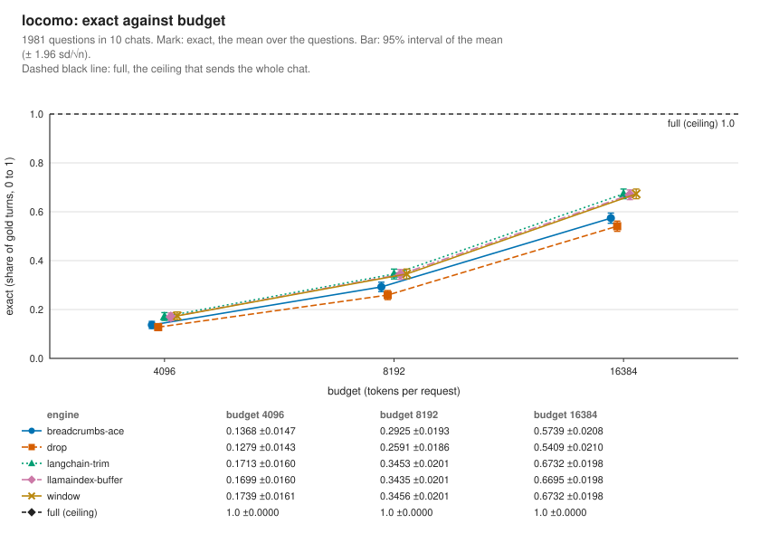

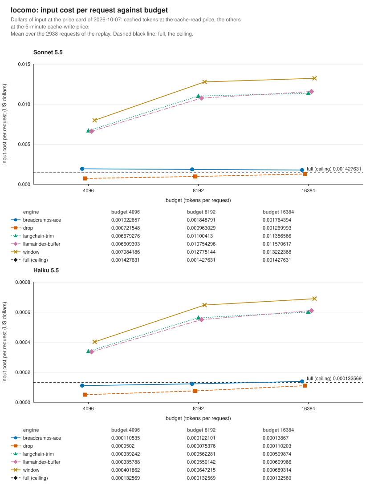

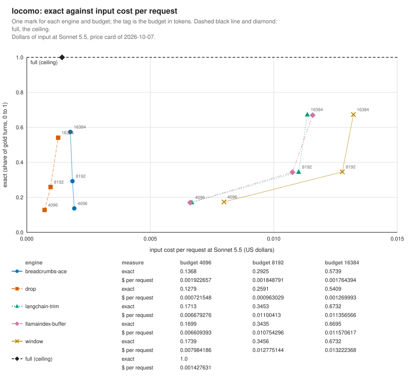

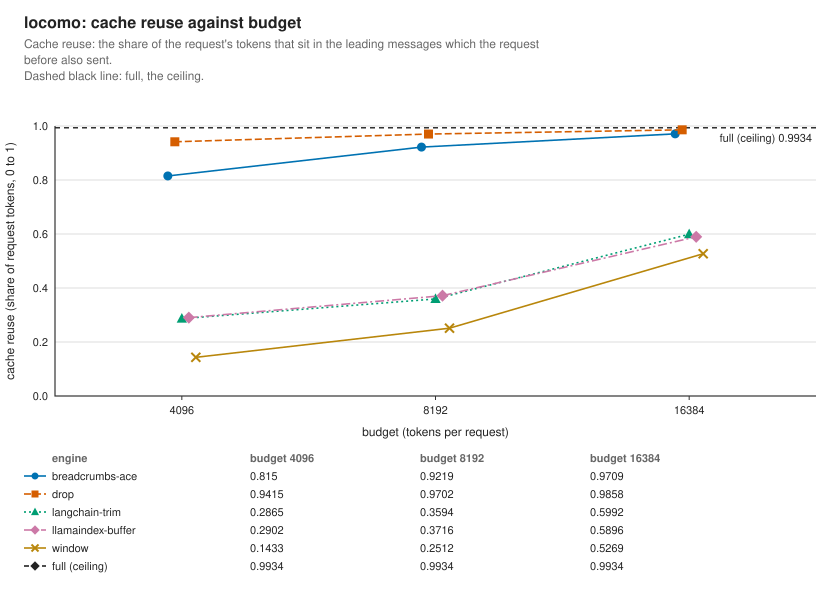

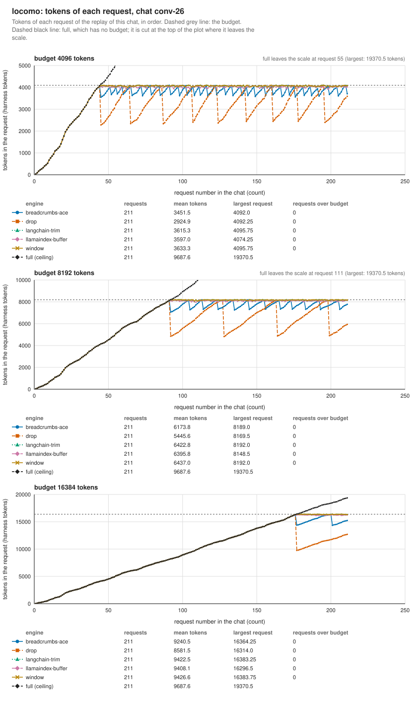

## longmemeval-s, budget 8192 tokens

Chats: 419. Questions: 419. Requests per engine: 102236. Source SHA-256: d6f21ea9d60a…. Question set: ac5f16e1f5e4…. Price card: 2026-10-07.

| # | Engine | Version | Exact | Words | Context tokens | Tokens/request | Cost units/request | $/request Sonnet 5.5 | $/request Haiku 5.5 | Cache reuse | Max request | Requests over | Tokens over | Newest dropped | Select ms p50 |
|---|---|---|---|---|---|---|---|---|---|---|---|---|---|---|---|
| ceiling | full | 1 | 1.000 | 0.948 | 124669 | 62262 | 6811.9 | 0.007448 | 0.001614 | 0.992 | 129882 |  |  | 0 | 0.01 |
| 1 | langchain-trim | 1.8.0 | 0.073 | 0.490 | 7890 | 7589 | 6958.1 | 0.013696 | 0.000696 | 0.290 | 8192 | 0 | 0 | 4 | 0.32 |
| 2 | llamaindex-buffer | 0.14.25 | 0.073 | 0.490 | 7884 | 7586 | 6959.3 | 0.013699 | 0.000696 | 0.289 | 19201 | 4 | 17060 | 0 | 0.09 |
| 3 | window | 1 | 0.073 | 0.490 | 7934 | 7656 | 7570.5 | 0.014967 | 0.000757 | 0.227 | 19201 | 4 | 17060 | 0 | 0.04 |
| 4 | drop | 1 | 0.060 | 0.453 | 6325 | 6064 | 1744.9 | 0.002982 | 0.000174 | 0.837 | 19201 | 4 | 17060 | 0 | 0.03 |
| 5 | breadcrumbs-ace | 0.4.1 (5be1e74) | 0.053 | 0.539 | 7504 | 7232 | 3720.6 | 0.006979 | 0.000372 | 0.640 | 19417 | 124 | 44381 | 0 | 2.27 |

Head to head: the mean of (row − column) exact per question. ▲ the row is ahead and ▼ behind (the 95% interval excludes 0); = no clear difference. In brackets: questions won, tied and lost by the row.

| row − column | langchain-trim | llamaindex-buffer | window | drop | breadcrumbs-ace |
|---|---|---|---|---|---|
| langchain-trim |  | +0.000 = (0/419/0) | +0.000 = (0/419/0) | +0.014 ▲ (11/408/0) | +0.020 ▲ (16/403/0) |
| llamaindex-buffer | +0.000 = (0/419/0) |  | +0.000 = (0/419/0) | +0.014 ▲ (11/408/0) | +0.020 ▲ (16/403/0) |
| window | +0.000 = (0/419/0) | +0.000 = (0/419/0) |  | +0.014 ▲ (11/408/0) | +0.020 ▲ (16/403/0) |
| drop | -0.014 ▼ (0/408/11) | -0.014 ▼ (0/408/11) | -0.014 ▼ (0/408/11) |  | +0.006 = (7/410/2) |
| breadcrumbs-ace | -0.020 ▼ (0/403/16) | -0.020 ▼ (0/403/16) | -0.020 ▼ (0/403/16) | -0.006 = (2/410/7) |  |

Clearly ahead: langchain-trim > drop; langchain-trim > breadcrumbs-ace; llamaindex-buffer > drop; llamaindex-buffer > breadcrumbs-ace; window > drop; window > breadcrumbs-ace.

Runner: breadcrumbs-agency (maintainer), macOS arm64, Python 3.14.7.

## longmemeval-s, budget 32768 tokens

Chats: 419. Questions: 419. Requests per engine: 102236. Source SHA-256: d6f21ea9d60a…. Question set: ac5f16e1f5e4…. Price card: 2026-10-07.

| # | Engine | Version | Exact | Words | Context tokens | Tokens/request | Cost units/request | $/request Sonnet 5.5 | $/request Haiku 5.5 | Cache reuse | Max request | Requests over | Tokens over | Newest dropped | Select ms p50 |
|---|---|---|---|---|---|---|---|---|---|---|---|---|---|---|---|
| ceiling | full | 1 | 1.000 | 0.948 | 124669 | 62262 | 6811.9 | 0.007448 | 0.001614 | 0.992 | 129882 |  |  | 0 | 0.01 |
| 1 | breadcrumbs-ace | 0.4.1 (5be1e74) | 0.380 | 0.792 | 28611 | 25536 | 4592.5 | 0.006809 | 0.000459 | 0.931 | 32768 | 0 | 0 | 0 | 1.50 |
| 2 | langchain-trim | 1.8.0 | 0.304 | 0.758 | 32452 | 28139 | 22918.3 | 0.044771 | 0.002292 | 0.379 | 32768 | 0 | 0 | 0 | 0.53 |
| 3 | llamaindex-buffer | 0.14.25 | 0.304 | 0.758 | 32417 | 28130 | 22903.5 | 0.044741 | 0.002290 | 0.379 | 32751 | 0 | 0 | 0 | 0.40 |
| 4 | window | 1 | 0.304 | 0.758 | 32513 | 28203 | 24811.7 | 0.048715 | 0.002481 | 0.322 | 32768 | 0 | 0 | 0 | 0.15 |
| 5 | drop | 1 | 0.266 | 0.739 | 27871 | 23191 | 3522.2 | 0.004830 | 0.000352 | 0.955 | 32768 | 0 | 0 | 0 | 0.09 |

Head to head: the mean of (row − column) exact per question. ▲ the row is ahead and ▼ behind (the 95% interval excludes 0); = no clear difference. In brackets: questions won, tied and lost by the row.

| row − column | breadcrumbs-ace | langchain-trim | llamaindex-buffer | window | drop |
|---|---|---|---|---|---|
| breadcrumbs-ace |  | +0.076 ▲ (59/360/0) | +0.076 ▲ (59/360/0) | +0.076 ▲ (59/360/0) | +0.114 ▲ (87/332/0) |
| langchain-trim | -0.076 ▼ (0/360/59) |  | +0.000 = (0/419/0) | +0.000 = (0/419/0) | +0.038 ▲ (32/387/0) |
| llamaindex-buffer | -0.076 ▼ (0/360/59) | +0.000 = (0/419/0) |  | +0.000 = (0/419/0) | +0.038 ▲ (32/387/0) |
| window | -0.076 ▼ (0/360/59) | +0.000 = (0/419/0) | +0.000 = (0/419/0) |  | +0.038 ▲ (32/387/0) |
| drop | -0.114 ▼ (0/332/87) | -0.038 ▼ (0/387/32) | -0.038 ▼ (0/387/32) | -0.038 ▼ (0/387/32) |  |

Clearly ahead: breadcrumbs-ace > langchain-trim; breadcrumbs-ace > llamaindex-buffer; breadcrumbs-ace > window; breadcrumbs-ace > drop; langchain-trim > drop; llamaindex-buffer > drop; window > drop.

Runner: breadcrumbs-agency (maintainer), macOS arm64, Python 3.14.7.

## longmemeval-s, budget 65536 tokens

Chats: 419. Questions: 419. Requests per engine: 102236. Source SHA-256: d6f21ea9d60a…. Question set: ac5f16e1f5e4…. Price card: 2026-10-07.

| # | Engine | Version | Exact | Words | Context tokens | Tokens/request | Cost units/request | $/request Sonnet 5.5 | $/request Haiku 5.5 | Cache reuse | Max request | Requests over | Tokens over | Newest dropped | Select ms p50 |
|---|---|---|---|---|---|---|---|---|---|---|---|---|---|---|---|
| ceiling | full | 1 | 1.000 | 0.948 | 124669 | 62262 | 6811.9 | 0.007448 | 0.001614 | 0.992 | 129882 |  |  | 0 | 0.01 |
| 1 | breadcrumbs-ace | 0.4.1 (5be1e74) | 0.582 | 0.881 | 56912 | 44861 | 6268.5 | 0.008206 | 0.000627 | 0.965 | 65536 | 0 | 0 | 0 | 1.94 |
| 2 | langchain-trim | 1.8.0 | 0.545 | 0.871 | 65212 | 48052 | 30846.8 | 0.059153 | 0.003085 | 0.529 | 65536 | 0 | 0 | 0 | 0.55 |
| 3 | llamaindex-buffer | 0.14.25 | 0.545 | 0.871 | 65157 | 48053 | 30860.8 | 0.059182 | 0.003086 | 0.528 | 65486 | 0 | 0 | 0 | 0.61 |
| 4 | window | 1 | 0.545 | 0.871 | 65269 | 48115 | 33230.0 | 0.064120 | 0.003323 | 0.486 | 65536 | 0 | 0 | 0 | 0.27 |
| 5 | drop | 1 | 0.405 | 0.822 | 44587 | 41436 | 5265.9 | 0.006486 | 0.000527 | 0.976 | 65536 | 0 | 0 | 0 | 0.17 |

Head to head: the mean of (row − column) exact per question. ▲ the row is ahead and ▼ behind (the 95% interval excludes 0); = no clear difference. In brackets: questions won, tied and lost by the row.

| row − column | breadcrumbs-ace | langchain-trim | llamaindex-buffer | window | drop |
|---|---|---|---|---|---|
| breadcrumbs-ace |  | +0.037 ▲ (34/383/2) | +0.037 ▲ (34/383/2) | +0.037 ▲ (34/383/2) | +0.177 ▲ (133/286/0) |
| langchain-trim | -0.037 ▼ (2/383/34) |  | +0.000 = (0/419/0) | +0.000 = (0/419/0) | +0.140 ▲ (112/307/0) |
| llamaindex-buffer | -0.037 ▼ (2/383/34) | +0.000 = (0/419/0) |  | +0.000 = (0/419/0) | +0.140 ▲ (112/307/0) |
| window | -0.037 ▼ (2/383/34) | +0.000 = (0/419/0) | +0.000 = (0/419/0) |  | +0.140 ▲ (112/307/0) |
| drop | -0.177 ▼ (0/286/133) | -0.140 ▼ (0/307/112) | -0.140 ▼ (0/307/112) | -0.140 ▼ (0/307/112) |  |

Clearly ahead: breadcrumbs-ace > langchain-trim; breadcrumbs-ace > llamaindex-buffer; breadcrumbs-ace > window; breadcrumbs-ace > drop; langchain-trim > drop; llamaindex-buffer > drop; window > drop.

Runner: breadcrumbs-agency (maintainer), macOS arm64, Python 3.14.7.

### Charts of longmemeval-s

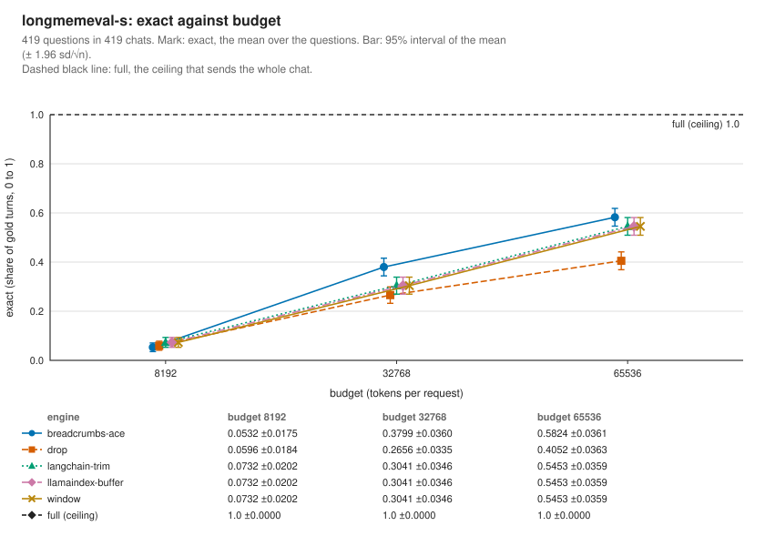

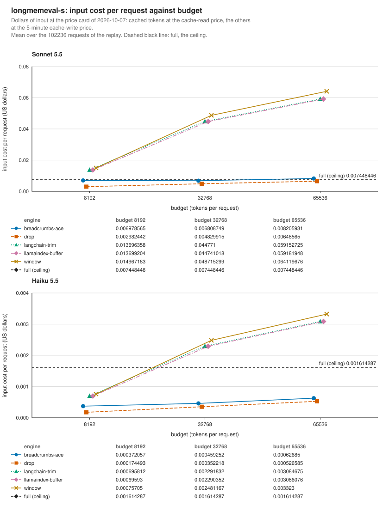

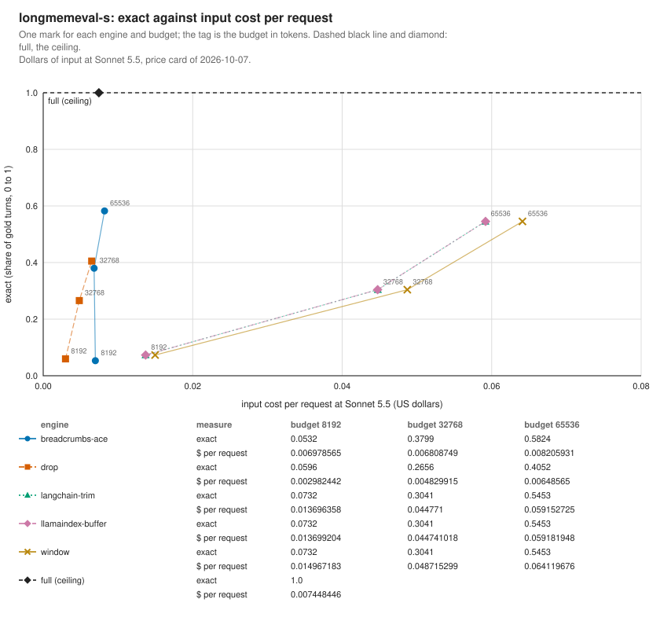

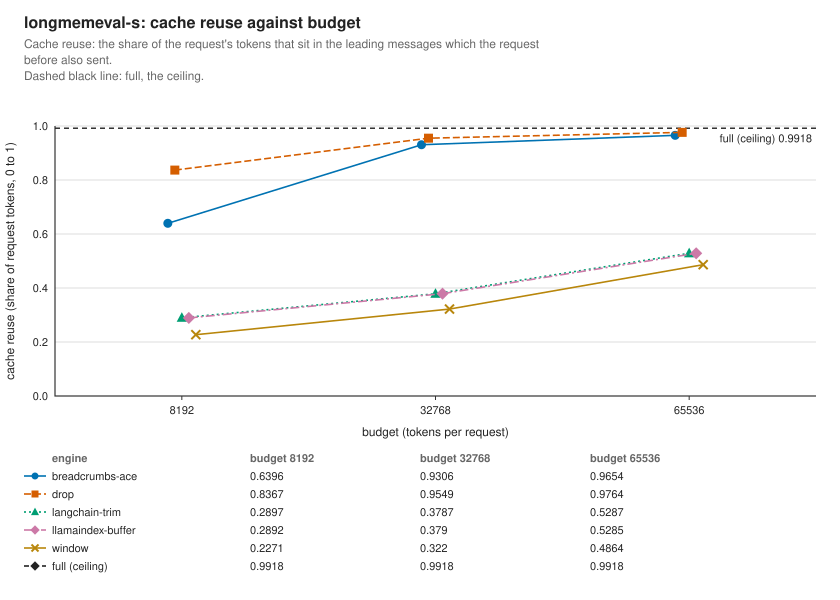

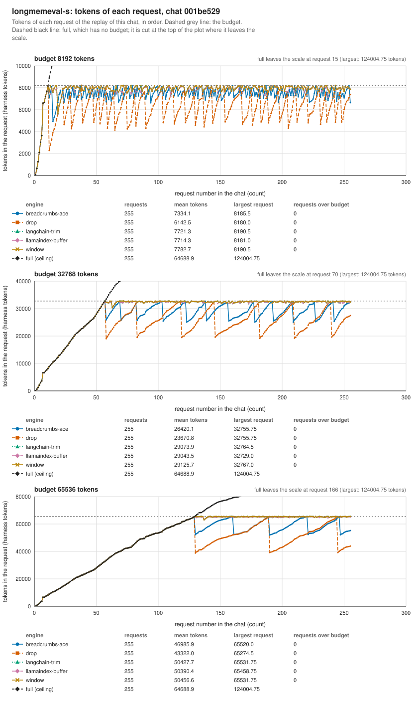

